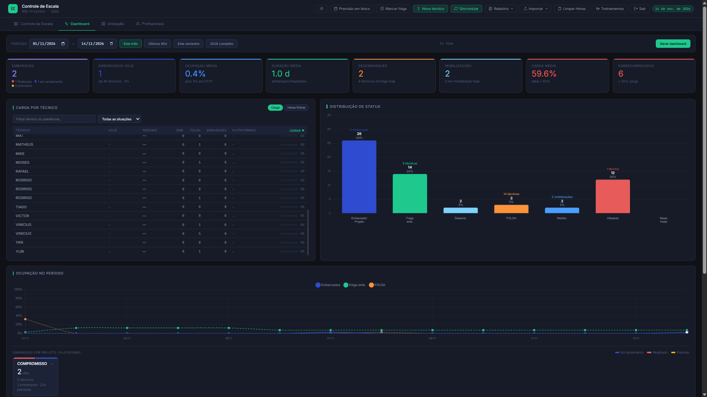

# EC-Controle-de-Escala



Aplicação web para controle de escala de técnicos embarcados. Permite acompanhar, dia a dia, o status de cada técnico (trabalho, folga, férias, treinamento, etc.), prever escalas em bloco, controlar horas reais e extras, e gerar relatórios em Excel. Os dados ficam em um banco Supabase, com sincronização automática a cada alteração, o que substitui planilhas espalhadas e facilita a consolidação mensal.

## Funcionalidades

- **Login** com usuário e senha, verificado por uma função RPC (`login_check`) no Supabase; a sessão fica salva no navegador até clicar em "Sair" (`js/controller/AuthController.js`).
- **Quadro de escala** com um técnico por linha e os dias do período na horizontal, com navegação por janela de dias, por mês e botão "Hoje", além de busca e filtros (`js/view/TableView.js`, `js/view/BoardView.js`, `js/controller/NavController.js`).
- **Edição de um dia** (status personalizado e marcação de folga) (`js/controller/CellController.js`).
- **Modo "Marcar folga"**: marca ou desmarca folga clicando ou arrastando nas células, sem alterar o status do dia (`js/controller/FolgaToggleController.js`).
- **Arrastar para preencher** vários dias de uma vez, com gravação no banco (`js/controller/DragFillController.js`).
- **Previsão em bloco**: aplica um status em um intervalo de datas para um ou mais técnicos (`js/controller/BlockController.js`).
- **Cadastro de técnicos**: novo, edição e remoção (`js/controller/TecnicoController.js`).
- **Tipos de treinamento** configuráveis, usados para reconhecer status de treinamento e curso (`js/controller/TrainingController.js`).
- **Sincronização**: salva automaticamente cada alteração; o botão "Sincronizar" pausa e retoma o envio, e um indicador mostra erros de sincronização (`js/controller/SyncController.js`).
- **Importação de horas reais** de arquivos `.xlsx`, com associação entre nomes da planilha e técnicos cadastrados (`js/controller/ImportController.js`).
- **Importação de escala** a partir de `.xlsx`, com escolha do período e prévia antes de gravar (`js/controller/ScaleImportController.js`).
- **Relatório quinzenal em Excel** (`js/controller/ReportController.js`).
- **Relatório "Tomador de Obras"**, que indica por técnico e por trecho do período a empresa tomadora do serviço (`js/controller/TomadorController.js`).
- **Painel com gráficos** (Chart.js), resumo semanal e aba de horas extras com filtro (`js/view/PanelViews.js`).
- **Modo claro e escuro** (`js/controller/NavController.js`).

## Tecnologias

- JavaScript puro (sem framework), organizado em modelo, visão e controladores (MVC simples)
- HTML5 e CSS3
- [Supabase](https://supabase.com) (banco PostgreSQL, funções RPC e RLS) acessado com `@supabase/supabase-js` v2, carregado por CDN (jsDelivr)
- [Chart.js](https://www.chartjs.org) (arquivo local em `vendor/`)
- [SheetJS (xlsx)](https://sheetjs.com) para ler e gerar planilhas (arquivo local em `vendor/`)
- Google Fonts (Inter e JetBrains Mono)

## Estrutura

```
EC-Controle-de-Escala/
├── index.html                    # Página principal e tela de login
├── css/styles.css                # Estilos (inclui modo escuro)
├── js/
│   ├── config.js                 # Configuração do Supabase (ver Observações)
│   ├── app.js                    # Ponto de entrada: carrega dados e renderiza
│   ├── lib/supabaseClient.js     # Cliente Supabase compartilhado
│   ├── model/                    # Estado e acesso a dados (AppState, EscalaModel, TecnicoModel, seedData)
│   ├── view/                     # Renderização (tabela, painéis, modais, quadro)
│   └── controller/               # Ações do usuário (login, edição, importação, relatórios, sincronização)
└── vendor/                       # Chart.js e SheetJS (xlsx)
```

## Como executar

O projeto é estático: não há comando de build nem de instalação.

1. Confirme que o projeto Supabase está configurado (tabelas, função `login_check` e políticas de acesso), conforme a seção Observações.
2. Abra o arquivo `index.html` no navegador. Para evitar restrições do navegador, também é possível servi-lo com um servidor estático simples, por exemplo `python -m http.server` na pasta do projeto, e acessar `http://localhost:8000`.
3. Faça login com um usuário cadastrado na tabela de usuários do Supabase.

## Observações

- **Credenciais no repositório**: o arquivo `js/config.js` contém a URL e a chave pública (anon) do Supabase versionadas no Git. O próprio comentário do arquivo diz que a chave é protegida por RLS. Mesmo assim, recomenda-se mover essa configuração para fora do versionamento ou usar valores de exemplo no repositório.
- **Login apenas na interface**: segundo o comentário em `AuthController.js`, a tela de login é uma trava de interface. Quem usar a API do Supabase diretamente com a chave pública ainda pode acessar as tabelas de escala e técnicos, dependendo das políticas RLS. Vale revisar essas políticas antes de uso real.
- **Esquema do banco não versionado**: o repositório não contém os scripts SQL das tabelas (`tecnicos`, `escala`, `users`), da função `login_check` nem das políticas RLS. A estrutura exata do banco precisa ser confirmada no painel do Supabase.
- **Dados de exemplo**: `js/model/seedData.js` traz dados iniciais embutidos no código. Não foi confirmado se eles são usados em produção ou apenas como carga de teste.
- **Dependência de internet**: o cliente Supabase é carregado por CDN, então sem internet o sistema não sincroniza. O código possui um estado `offline`, mas o comportamento completo offline não foi confirmado.
- Não há testes automatizados nem arquivo de licença no repositório.

## Autor

Desenvolvido por [Juliano Sobrinho](https://github.com/JuhhSobrinho).
